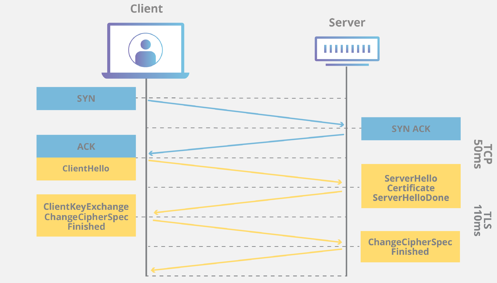

# Aula 17 - Segurança no Backend

**Sumário**

- [Aula 17 - Segurança no Backend](#aula-17---segurança-no-backend)
  - [HTTPS](#https)
    - [TLS *Handshake*](#tls-handshake)
  - [OWASP](#owasp)
    - [OWASP *Risks*](#owasp-risks)
    - [ASVS - *Application Security Verification Standard*](#asvs---application-security-verification-standard)
  - [Ataques conhecidos](#ataques-conhecidos)
  - [API Security Best Practices](#api-security-best-practices)
  - [Outros conceitos relacionados](#outros-conceitos-relacionados)

## HTTPS

O *Hypertext Transfer Protocol Secure* é definido nos seguintes RFCs:

- [9110 - HTTP Semantics](https://www.rfc-editor.org/rfc/rfc9110.html), que define a estrutura central, semântica e os esquemas "http" e "https".
- [8446 - TLS 1.3](https://www.rfc-editor.org/rfc/rfc8446.html): protocolo de criptografia usado no HTTPS.

O HTTPS é basicamente o HTTP executando sobre o TLS/SSL. Utiliza a porta 443, e a criptografia ocorre com a utilização do TLS (*Transport Layer Security*), de forma assíncrona:

1. **Chave privada**: controlada pelo dono do site, e fica armazenada em um servidor web para descriptografar as informações criptografadas com a chave pública.
2. **Chave pública**: disponível publicamente, via certificado SSL, para todos que queiram interagir com um servidor de uma maneira segura. As informações criptografadas com essa chave só podem ser descriptografadas pela chave privada.

Um certificado SSL pode ser comprado de algum provedor de serviço de hospedagem. Esse certificado pode ser compartilhado por vários usuários (*multi-domain SSL certificate*), ou pode ser individual (o que costuma ser mais caro). Dependendo do provedor de hospedagem, é possível ter um certificado compartilhado gratuito.

Os parâmetros criptográficos usados pelo canal seguro são produzidos pelo **subprotocolo de *handshake* do TLS**, o qual é utilizado na primeira comunicação entre cliente e servidor. Durante o *handshake*, cliente e servidor:

- Especificam qual versão do TLS (TLS 1.0, 1.2, 1.3, etc.) será usado.
- Decidem quais conjuntos de cifras serão utilizados.
- Autenticam a identidade do servidor por meio da chave pública do servidor e da assinatura digital da autoridade de certificação SSL.
- Geram as chaves **de sessão** a fim de usar criptografia simétrica após a realização do *handshake*.

### TLS *Handshake*

    
    
O <i>handshake</i> é composto por 3 fases:

    <ol>
        <li><b><i>Key Exchange</i></b>: estabelece um material de chaveamento compartilhado e seleciona os parâmetros criptográficos. Tudo o que ocorre após essa fase é criptografado.
            <ul>
                <li>O cliente envia a mensagem <code>ClientHello</code>, a qual contém
                    <ul>
                        <li>Um <code>nonce</code> (<i>number used once</i>) aleatório; </li>
                        <li>Versões de protocolo oferecidas;</li>
                        <li>Uma lista de pares de cifra simétrica/hash HKDF;</li>
                        <li>Um conjunto de compartilhamentos de chave Diffie-Hellman, ou um conjunto de rótulos de chave pré-compartilhada, ou ambos;</li>
                        <li>Potencialmente extensões adicionais.</li>
                    </ul>
                </li>
            </ul>
        </li>
        <li><b><i>Server Parameters</i></b>: estabelece outros parâmetros de <i>handshake</i> (se o clente está autenticado, suporte ao protocolo da camada de aplicação, etc.)
            <ul>
                <li>O servidor processa o <code>ClientHello</code> e determina os parâmetros criptográficos apropriados para a conexão, e responde com seu <code>ServerHello</code>, indicando os parâmetros negociados. A combinação de <code>ClientHello</code> e <code>ServerHello</code> determina as chaves compartilhadas.</li>
                <li>O servidor então envia duas mensagens para estabelecer os Parâmetros de Servidor:
                    <ul>
                        <li><code>EncryptedExtensions</code>: respostas para as extensões de <code>ClientHello</code> que não são necessárias para determinar os parâmetros criptográficos, exceto aquelas específicas de certificados individuais.</li>
                        <li><code>CertificateRequest</code>: caso seja desejada a autenticação do cliente baseada em certificado, os parâmetros desejados para esse certificado serão informados. Esta mensagem será omitida caso a autenticação do cliente não seja desejada.</li>
                    </ul>
                </li>
            </ul>
        </li>
        <li><b><i>Authentication</i></b>: autentica o servidor (e, opcionalmente, o cliente) e fornece confirmação de chave e integridade do <i>handshake</i>
            <ul>
                <li>Finalmente, o cliente e o servidor trocam mensagens de autenticação. O TLS usa o mesmo conjunto de mensagens sempre que a autenticação baseada em certificado é necessária. Especificamente:
                    <ul>
                        <li><code>Certificate</code>: O certificado do <i>endpoint</i> e quaisquer extensões por certificado. Esta mensagem é omitida pelo servidor se a autenticação não for feita com um certificado e pelo cliente se o servidor não enviou um <code>CertificateRequest</code> (indicando, portanto, que o cliente não deve se autenticar com um certificado).</li>
                        <li><code>CertificateVerify</code>: Uma assinatura de todo o <i>handshake</i> usando a chave privada correspondente à chave pública na mensagem de certificado. Esta mensagem é omitida se o <i>endpoint</i> não estiver autenticando por meio de um certificado.</li>
                        <li><code>Finished</code>: Um MAC (<i>Message Authentication Code</i>) sobre todo o <i>handshake</i>. Esta mensagem fornece confirmação da chave e vincula a identidade do <i>endpoint</i> às chaves trocadas.</li>
                    </ul>
                </li>
                <li>Ao receber as mensagens do servidor, o cliente responde com suas mensagens de autenticação, ou seja, <code>Certificate</code> e <code>CertificateVerify</code> (se solicitado) e <code>Finished</code>.</li>
            </ul>
        </li>
    </ol>

Detalhes das etapas do *handshake* do TLS 1.3: [RFC 8446 - Seção 4](https://www.rfc-editor.org/rfc/rfc8446.html#page-24).

## [OWASP](https://owasp.org/about/)

A *Open Worldwide Application Security Project* (OWASP) é uma fundação sem fins lucrativos que trabalha para melhorar a segurança de software, lançada em 1º de dezembro de 2001 e incorporada como uma organização sem fins lucrativos dos Estados Unidos em 21 de abril de 2004.

Eles se definem como uma comunidade aberta dedicada a capacitar organizações a conceber, desenvolver, adquirir, operar e manter aplicações confiáveis. Seus projetos, ferramentas, documentos, fóruns e capítulos são gratuitos e abertos a qualquer pessoa interessada em aprimorar a segurança de aplicações.

### OWASP *Risks*

Os OWASP *Risks* consistem em um top 10 riscos de segurança de aplicação web. O [top 10 de 2025](https://owasp.org/Top10/2025/) inclui os seguintes riscos:

- A01:2025 - [*Broken Access Control*](https://top10.owasp.org/2025/A01_2025-Broken_Access_Control/). Alguns exemplos de vulnerabilidade:
  - Contorno das verificações de controle de acesso a partir da modificação da URL, do estado interno da aplicação, ou da página HTML, ou pelo uso de uma ferramenta de ataque que modifica requisições de API.
  - Permissão de visualização ou edição de conta de terceiro pelo fornecimento de seu identificador único.
  - API acessível sem controles de acesso para POST, PUT e DELETE.
- A02:2025 - [*Security Misconfiguration*](https://top10.owasp.org/2025/A02_2025-Security_Misconfiguration/). Alguns exemplos de vulnerabilidade:
  - Funcionalidades desnecessárias estão habilitadas ou instaladas (por exemplo, portas, serviços, páginas, contas, estruturas de teste ou privilégios desnecessários).
  - As contas padrão e suas respectivas senhas permanecem ativadas e inalteradas.
- A03:2025 - [*Software Supply Chain Failures*](https://top10.owasp.org/2025/A03_2025-Software_Supply_Chain_Failures/). Alguns exemplos de vulnerabilidade:
  - Você não monitora cuidadosamente as versões de todos os componentes que utiliza (tanto do lado do cliente quanto do servidor). Isso inclui componentes que você usa diretamente, bem como dependências aninhadas (transitivas).
  - O software é vulnerável, não tem suporte ou está desatualizado. Isso inclui o sistema operacional, o servidor web/de aplicativos, o sistema de gerenciamento de banco de dados (SGBD), os aplicativos, as APIs e todos os componentes, os ambientes de execução e as bibliotecas.
- A04:2025 - [*Cryptographic Failures*](https://top10.owasp.org/2025/A04_2025-Cryptographic_Failures/). Alguns exemplos de vulnerabilidade:
  - Existem algoritmos ou protocolos criptográficos antigos ou fracos sendo usados ​​por padrão ou em códigos mais antigos?
  - O certificado do servidor recebido e a cadeia de confiança foram devidamente validados?
- A05:2025 - [*Injection*](https://top10.owasp.org/2025/A05_2025-Injection/). Alguns exemplos de vulnerabilidade:
  - Os dados fornecidos pelo usuário não são validados, filtrados ou higienizados pelo aplicativo.
  - Dados não sanitizados são usados ​​nos parâmetros de pesquisa de mapeamento objeto-relacional (ORM) para extrair registros adicionais e sensíveis.
- A06:2025 - [*Insecure Design*](https://top10.owasp.org/2025/A06_2025-Insecure_Design/).
- A07:2025 - [*Authentication Failures*](https://top10.owasp.org/2025/A07_2025-Authentication_Failures/). Alguns exemplos de vulnerabilidade:
  - Permite ataques de força bruta ou outros ataques automatizados e programados que não são bloqueados rapidamente.
  - Permite senhas padrão, fracas ou conhecidas, como o nome de usuário "Password1" ou "admin" com a senha "admin".
- A08:2025 - [*Software or Data Integrity Failures*](https://top10.owasp.org/2025/A08_2025-Software_or_Data_Integrity_Failures/).
- A09:2025 - [*Security Logging and Alerting Failures*](https://top10.owasp.org/2025/A09_2025-Security_Logging_and_Alerting_Failures/). Alguns exemplos de vulnerabilidade:
  - Eventos auditáveis, como logins, falhas de login e transações de alto valor, não são registrados ou são registrados de forma inconsistente (por exemplo, registrando apenas logins bem-sucedidos, mas não tentativas malsucedidas).
  - Você fica vulnerável ao vazamento de informações confidenciais ao tornar os eventos de registro e alerta visíveis para um usuário ou invasor, ou ao registrar informações confidenciais que não deveriam ser registradas.
- A10:2025 - [*Mishandling of Exceptional Conditions*](https://top10.owasp.org/2025/A10_2025-Mishandling_of_Exceptional_Conditions/).

### [ASVS - *Application Security Verification Standard*](https://asvs.owasp.org/)

Esse projeto fornece uma base para testar os controles técnicas de segurança de aplicações web e também oferece aos desenvolvedores uam lista de requisitos para o desenvolvimento seguro.

O texto em [Inglês](https://github.com/OWASP/ASVS/blob/v5.0.0/5.0/OWASP_Application_Security_Verification_Standard_5.0.0_en.pdf) e sua tradução oficial em [PT-BR](https://github.com/OWASP/ASVS/blob/v5.0.0/5.0/OWASP_Application_Security_Verification_Standard_5.0.0_pt.pdf).

## Ataques conhecidos

O OWASP disponibiliza uma [lista de ataques](https://community.owasp.org/attacks/) utilizados para a exploração de vulnerabilidades. Alguns dos mais conhecidos são:

- [Buffer Overflow Attack](https://community.owasp.org/attacks/Buffer_overflow_attack)
- [Cross Site Scripting - XSS](https://community.owasp.org/attacks/xss/)
- [Clickjacking](https://community.owasp.org/attacks/Clickjacking)
- [Denial of Service](https://community.owasp.org/attacks/Denial_of_Service)
- [SQL Injection](https://community.owasp.org/attacks/SQL_Injection)

## API Security Best Practices

A seguir, um [link](https://roadmap.sh/api-security-best-practices) para uma lista de melhores práticas de segurança para APIs.

## Outros conceitos relacionados

- [Hardened server](https://www.sophos.com/en-us/cybersecurity-explained/what-is-server-hardening)
- [*Content Security Policy* (CSP)](https://developer.mozilla.org/en-US/docs/Web/HTTP/Guides/CSP)